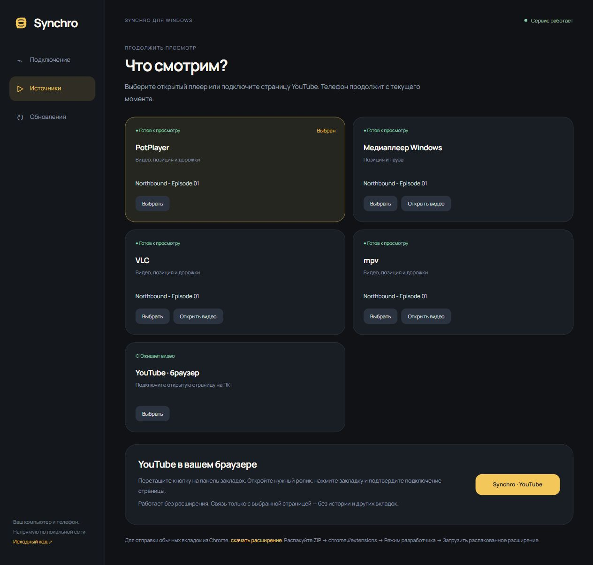
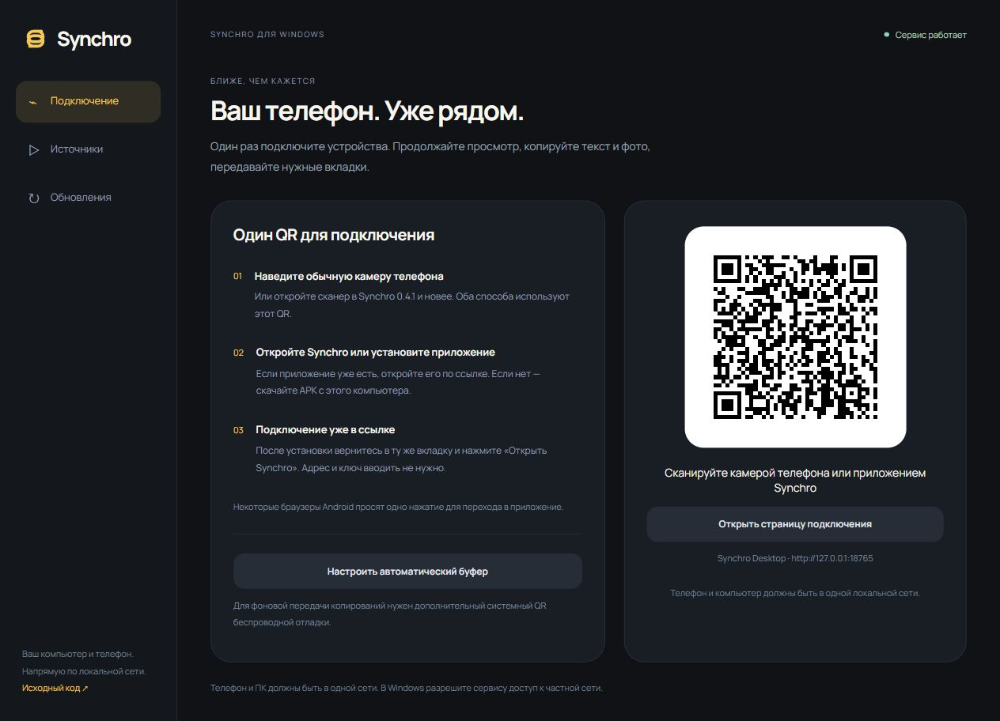

<p align="center"></p>
<p align="center"><a href="https://github.com/giveuper39/Synchro-Desktop/releases/latest"><strong>Скачать для Windows</strong></a> · <a href="https://github.com/giveuper39/Synchro-Android">Приложение Android</a> · <a href="docs/PAIRING.md">Подключение</a></p>

Synchro связывает ваш компьютер и телефон по локальной сети. Продолжайте фильм в другой комнате, копируйте текст и фотографии между устройствами, отправляйте нужную вкладку.



## Начать пользоваться

1. Скачайте Windows ZIP, распакуйте **всю папку** и запустите `Synchro.cmd`.
2. Отсканируйте основной QR обычной камерой телефона или сканером Synchro. Если приложения нет, ссылка предложит скачать APK с этого ПК. После установки вернитесь в ту же вкладку и откройте Synchro.
3. Откройте видео на ПК, выберите источник в Synchro и нажмите на телефоне **Продолжить на телефоне**.

ПК поставит видео на паузу. Пауза на телефоне вернёт текущую серию и позицию на компьютер. Громкость и настройки экрана остаются локальными.

Python и ADB включены в сборку. Плееры устанавливаются отдельно. Нужны Windows 10/11, Android 8+ и одна локальная сеть.

## Источники просмотра

| Источник на ПК | Как подключить | Что возвращается с телефона |
| --- | --- | --- |
| **PotPlayer** | Открыть локальное видео как обычно | Файл/серия, позиция, озвучка, встроенные субтитры и задержка; скорость при поддержке плеера |
| **Медиаплеер Windows** | Открыть видео в стандартном современном Media Player | Файл/серия, позиция и пауза |
| **VLC** | Открыть видео через раздел «Источники» Synchro | Плейлист, позиция, дорожки, задержка и скорость |
| **mpv** | Открыть видео через раздел «Источники» Synchro | Плейлист, позиция, дорожки, задержка и скорость |
| **YouTube** | Единое расширение Synchro; открытые ролики появляются автоматически | Ролик, позиция, пауза и скорость; ограничения описаны ниже |

Локальные файлы передаются напрямую с поддержкой HTTP Range, без перекодирования. Windows Media Player не предоставляет API выбора озвучки и субтитров, поэтому эти кнопки для него скрыты. У VLC/mpv канал управления создаётся при запуске через Synchro. Внешние файлы субтитров пока не передаются. Подробности — [работа с плеерами](docs/PLAYER.md).

Для YouTube и вкладок используется одно расширение **Synchro**. При первом старте сервер готовит постоянную папку и открывает раздел **Браузер** с установкой. Один раз включите режим разработчика в `chrome://extensions` и загрузите указанную папку. ZIP скачивать не нужно. Открытые ролики подключаются автоматически, включая уже открытые вкладки и переходы между видео.

Chrome на обычном Windows-ПК требует подтверждения первой загрузки локального расширения вне Web Store. Политики и профиль браузера Synchro не меняет. На Android работает официальный встроенный YouTube Player с его ограничениями встраивания. [Устройство и проверка расширения](docs/YOUTUBE_CONNECTOR.md).

## Буфер и вкладки

**Текст и фото — в обе стороны.** Synchro передаёт только последнее копирование: следующее заменяет предыдущее. История копирований не сохраняется. Изображения приводятся к PNG с учётом ориентации; метаданные фотографии удаляются. Поддерживаются изображения до 32 МиБ и 64 Мп. Скопированная ссылка на картинку и файл из Проводника не считаются изображением в буфере.

Для автоматического фонового буфера один раз подключите Android через **системный QR беспроводной отладки** в мастере. Это стандартный ADB-доступ выбранному ПК. При выключенной отладке остаётся ручная передача из приложения и через «Поделиться». Полученное содержимое помечается для исключения из штатной истории Win+V и облачного буфера Windows; сторонние менеджеры буфера управляются отдельно.

**Вкладки.** На телефоне: Opera или другой браузер → Поделиться → Synchro → отправить на ПК. На компьютере: значок того же расширения Synchro → кнопка или свайп вправо. Адрес и ключ подхватываются автоматически. Доступ к медиаплееру нужен только на YouTube; обычные страницы отправляются явно. История браузера не запрашивается.

<details><summary>Мастер подключения</summary>



QR на скриншоте демонстрационный. Адрес и ключ реального компьютера создаются локально.
</details>

## Обновления

В мастере откройте **Обновления → Проверить версию**. Переносимая сборка обновляется из стабильного GitHub Release: проверяется SHA-256, настройки сохраняются, при неудачном запуске возвращается предыдущая версия. Во время просмотра на телефоне установка ждёт паузы. Второй запуск сервиса открывает уже работающий экземпляр.

Установки 0.3.x получают миграционное обновление через прежние адреса репозиториев; после перехода используется Synchro. Исходный checkout обновляется через Git.

## Разработка

```sh
python -m pip install -e server
Synchro --open
python -m unittest discover -s tests
node --test chrome-extension/protocol.test.mjs chrome-extension/youtube.test.mjs tests/youtube_connector.test.mjs tests/pairing_page.test.mjs
```

Python 3.11+. `ffprobe` в PATH улучшает сопоставление дорожек, `ffmpeg` добавляет кадр превью. Они необязательны и в ZIP не входят.

| Каталог | Назначение |
| --- | --- |
| `server/synchro` | Сессии просмотра, HTTP, буфер, обнаружение и обновления |
| `player-integrations` | Публичные Windows API, VLC HTTP и mpv IPC |
| `clipboard-bridge` | Небольшой Android shell-мост последнего копирования |
| `chrome-extension` | Автоматическое подключение YouTube и отправка вкладок |
| `tests` | Изолированные протокольные и регрессионные проверки |
| `tools` | Сборка переносимого пакета и проверка релиза |

Сервис рассчитан на доверенную LAN: HTTP с ключом подключения, без открытия порта в интернет. Ключи, медиафайлы и содержимое буфера в Git и журналы не попадают. Нативные проверки и границы тестирования — [VALIDATION.md](VALIDATION.md).

[Сборка релиза](docs/RELEASING.md) · [YouTube](docs/YOUTUBE_CONNECTOR.md) · [Лицензии компонентов](THIRD_PARTY_NOTICES.md)

Собственный код — MIT. PotPlayer, Windows Media Player, VLC и mpv не входят в дистрибутив и не связаны с проектом.
